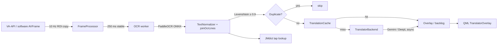

# สถาปัตยกรรม (Translator Core + GUI Hooks)

## หลักการ

1. **แยกโค้ดใหม่ทั้งหมดออกจาก upstream** — `translator_core/` เป็น static library
   ที่ไม่พึ่ง Qt/FFmpeg เพื่อให้คอมไพล์และเทสต์แยกได้ และลด merge conflict
2. **แตะ upstream เท่าที่จำเป็น** — จุดเชื่อมต่อมี 4 จุดเท่านั้น (ด้านล่าง)
3. **งานหนักอยู่นอก render thread** — render/decode thread คัดลอกเฉพาะ ROI แล้วจบ
   งาน OCR/แปล/พจนานุกรมอยู่ใน worker thread หรือ Qt network thread
4. **ทุกอย่างออฟไลน์ได้** ยกเว้น cloud translation; OCR กับพจนานุกรมทำงานในเครื่อง

## Data flow



## Threading model

| Thread | งาน | หมายเหตุ |
| --- | --- | --- |
| Qt GUI thread | settings, QML, network callbacks, dictionary tap | QNetworkAccessManager อยู่ที่นี่ |
| FFmpeg frame thread | `TranslatorManager::submitFrame` → คัดลอก ROI | throttle 10 Hz ก่อน `av_hwframe_transfer_data` |
| OCR worker (pipeline) | grayscale/diff/stabilize, preprocess, ONNX det+rec, dedup, cache | ตั้ง CPU affinity ได้ (ค่าเริ่มต้นคอร์ 2,3 บน Linux) |
| Qt network thread | Gemini/DeepL reply | callback กลับเข้าคิว GUI |

`TranslatorPipeline` ใช้ `SpscRingBuffer<QueuedFrame, 4>` ระหว่าง frame thread กับ worker
ถ้าคิวเต็มจะทิ้งเฟรมใหม่ (worker ตามไม่ทัน) ไม่บล็อก decoder

## Upstream hook points

ไฟล์ upstream ที่แก้ (diff เล็กที่สุด):

1. `gui/src/qmlbackend.cpp`
   - สร้าง `TranslatorManager` หลัง register QML singleton
   - หลัง `prepareFrameForPresentation(...)` เรียก `translator->submitFrame(frame.frame)`
   - ตอน session quit เรียก `translator->onSessionEnded()`
2. `gui/include/qmlbackend.h` — forward declaration + member ภายใต้ `CHIAKI_ENABLE_TRANSLATOR`
3. `gui/src/controllermanager.cpp` + `gui/include/controllermanager.h`
   - paddle เดิม `return false` (ไม่ส่งขึ้น PS5) → emit `PaddleButton(1..4, pressed)`
   - manager forward signal ไปยัง `TranslatorManager`
4. `gui/src/qml/StreamView.qml` — เพิ่ม `Loader { source: "translator/TranslatorOverlay.qml" }`
5. `gui/src/qml/qml.qrc` — เพิ่มไฟล์ overlay
6. `gui/CMakeLists.txt`, `CMakeLists.txt` — เพิ่ม subdirectory/source/link ภายใต้ option

> หมายเหตุ: แผนเดิมอ้าง `avframewidget.cpp` และ `ffmpegdecoder.cpp` ใน `gui/src/`
> แต่ upstream รุ่นปัจจุบันย้าย frontend เป็น QML (`qmlbackend.cpp`, `StreamView.qml`)
> และ decoder อยู่ที่ `lib/src/ffmpegdecoder.c` จึงย้าย hook ไปยังจุดที่เฟรมถูกส่งเข้า
> presentation แทน โดยยังคงหลักการเดิม: copy เฉพาะ ROI, ไม่ดึงเฟรมเต็มกลับมา

## Core API ย่อ

```cpp
trans::FrameProcessor processor(config);       // ROI + throttle + stabilization
trans::ProcessResult r = processor.processGray(gray, now_ms);
trans::OcrEngine      // null / paddle-onnx
trans::CtcDecoder     // CTC greedy + confidence
trans::JmDict         // SQLite JMdict, tokenizer, deinflection
trans::TranslatorBackend // async interface
trans::TranslatorPipeline // owns worker + dedup + cache + context
```

## Merge-conflict strategy

- โค้ดใหม่ 100% อยู่ใน `translator_core/`, `gui/src/translator/`, `gui/include/translator/`,
  `gui/src/qml/translator/`, `assets/`, `packaging/`, `scripts/translator/`
- upstream files แก้เฉพาะ hunk เล็ก ๆ ที่มี `#ifdef CHIAKI_ENABLE_TRANSLATOR`
  (ยกเว้นบรรทัด signal ของ paddle และ Loader ใน QML)
- เมื่อ upstream อัปเดต: `git fetch upstream && git rebase upstream/master`
  แล้วแก้ conflict เฉพาะ 6 จุดข้างต้น
- ฟีเจอร์ใหม่ที่ต้องแตะ upstream เพิ่ม ให้เพิ่มเป็น hook ใหม่ในไฟล์เดียวกัน
  ไม่กระจายการแก้หลายไฟล์

## การเลือกโมเดล

- **ตรวจข้อความ:** PP-OCRv3 DB segmentation (`ch_PP-OCRv3_det`) — ตรวจจับบรรทัดแนวนอน
  ได้ดี และใช้ได้กับข้อความญี่ปุ่น
- **อ่านตัวอักษร:** `japan_PP-OCRv3_rec` (CTC, 4401 classes) — เบา (~10 MB) และ
  ติดตั้งง่ายบน Deck
- **ข้อความแนวตั้ง:** เก็บกล่องตัวอักษร upright แล้วรวมคอลัมน์ด้วย `mergeVerticalLines`
  (ไม่หมุนภาพทั้งภาพ เพราะตัวอักษรญี่ปุ่นแนวตั้งไม่ได้หมุน 90°)
- **Manga-OCR:** เป็น encoder-decoder จึงยังไม่ฝังในรอบนี้; interface `OcrEngine`
  เปิดให้เพิ่มภายหลังได้โดยไม่แตะ pipeline

## ความปลอดภัยของข้อมูล

- API key เก็บใน `QSettings` (plain text) ตามข้อจำกัดของ upstream settings;
  แนะนำใช้บัญชี API แยกและจำกัด quota
- ไม่ log API key หรือ body ที่มี key; error message ถูกย่อความยาว
- ไม่ส่งภาพออกนอกเครื่อง ยกเว้นข้อความที่ OCR ได้และผู้ใช้เลือก cloud backend
